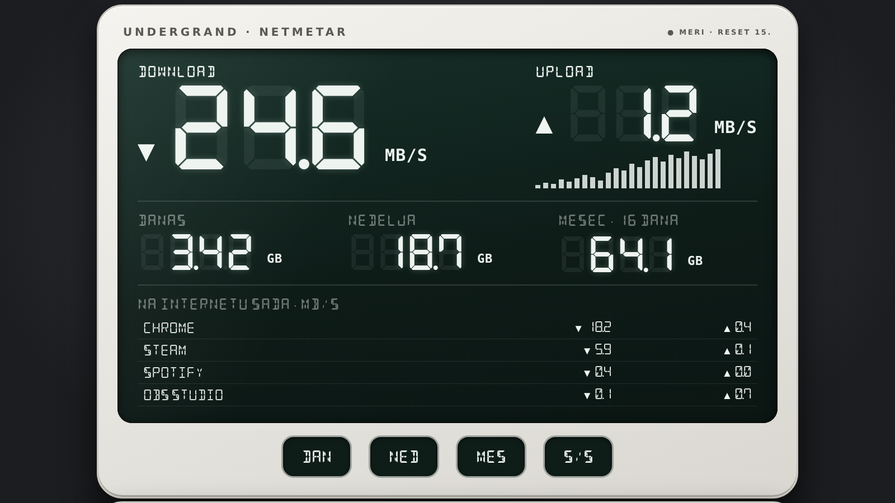

# BronxSoft Netmetar

> **English:** Netmetar is a small, free internet traffic meter for Windows in the look of an old LCD display:
> live download and upload speed with a graph, totals for today, the week and the billing month (with your own
> reset day), history, and the programs that are on the internet right now. The program speaks Serbian and
> English (Options). Status: **beta**.

Jednostavan merač internet saobraćaja za Windows, u izgledu starog LCD displeja, bez gomile opcija.
Program je na srpskom i engleskom (Opcije).



**Status: beta.**

## Šta radi

- Brzina preuzimanja i slanja uživo, jednom u sekundi, sa grafikonom poslednjih 30 sekundi i najvećom brzinom
  danas (KB/s, MB/s ili Mbit/s).
- Zbirovi za danas, ovu nedelju i obračunski mesec, sa danom resetovanja koji biraš sam i projekcijom do kraja
  perioda.
- Istorija po danima, nedeljama i obračunskim periodima, sa izvozom u CSV za Excel.
- Programi koji su upravo na internetu, sa ikonicama, vremenom provedenim na mreži danas, portovima i vezama.
  **Čuvar** javlja kad program pod nadzorom izgubi vezu.
- Tačna potrošnja po programu preko pomoćnog programa (`BronxSoft Netmetar Merac.exe`, traži administratorska
  prava jednom; uključuje se u Opcijama).
- Mali prikaz iznad sata, ikonica pored sata i pokretanje sa Windowsom.

Program ne šalje ništa na internet; samo meri saobraćaj na ovom računaru.

## Preuzimanje

Gotov program je na strani [Releases](../../releases): raspakuj zip i pokreni `BronxSoft Netmetar.exe`.

- Windows 10 ili 11, 64-bitni.
- Treba [.NET 10 Desktop Runtime](https://dotnet.microsoft.com/download/dotnet/10.0) (Windows ga ponudi pri
  prvom pokretanju ako ga nema).
- Program nije digitalno potpisan, pa Windows SmartScreen pri prvom pokretanju može da pita
  („Više informacija“ → „Svejedno pokreni“).
- Podaci programa (istorija i podešavanja) su u `%APPDATA%\BronxSoft Netmetar\`.

## Pravljenje iz koda

Treba [.NET 10 SDK](https://dotnet.microsoft.com/download). Program ne koristi dodatne pakete.

```bat
dotnet build Netmetar.csproj
```

`Napravi exe.bat` pravi `dist\BronxSoft Netmetar.exe` i pomoćni `dist\BronxSoft Netmetar Merac.exe`
(projekat u folderu `Merac/`). Istorija izmena je u [CHANGELOG.md](CHANGELOG.md) i u samom programu
(„Šta je novo“).

## Licenca

Kod Netmetra je pod licencom **MIT** (vidi [LICENSE](LICENSE)). Fontovi DSEG i Rajdhani su pod SIL Open Font
License 1.1; spisak je u [Licence.txt](Licence.txt).

## Autor

**BronxSoft**, Novi Sad. Program je besplatan i nema reklama.
